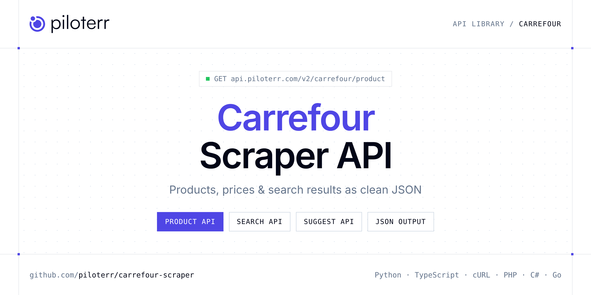

<p align="center">
  <a href="https://www.piloterr.com"></a>
</p>

# Carrefour Scraper API

[](https://discord.gg/CFj3ph8aHU) [](https://app.piloterr.com) [](https://app.piloterr.com/openapi) [](LICENSE)

The **Piloterr Carrefour Scraper API** lets you extract public data from Carrefour as **clean, structured JSON** — no proxies, headless browsers or HTML parsing to maintain. Endpoints available in production:

- **Carrefour Product API** — Extract full product details from a Carrefour product page, including price, brand, nutritional info, packaging, and availability.
- **Carrefour Search API** — Search for products on Carrefour by keyword or URL, returning structured listings with prices, ratings, and pagination.
- **Carrefour Suggest API** — Get product suggestions from Carrefour by keyword or EAN, returning matching products with pricing, availability, and product details.

Use it for price monitoring, assortment tracking, competitor analysis, product research or catalog enrichment.

| Endpoint | Path | Credits | What you get |
|---|---|---|---|
| [Carrefour Product API](#carrefour-product-api) | `/v2/carrefour/product` | 2 | Extract full product details from a Carrefour product page, including price, brand, nutritional info, packaging, and availability. |
| [Carrefour Search API](#carrefour-search-api) | `/v2/carrefour/search` | 2 | Search for products on Carrefour by keyword or URL, returning structured listings with prices, ratings, and pagination. |
| [Carrefour Suggest API](#carrefour-suggest-api) | `/v2/carrefour/suggest` | 1 | Get product suggestions from Carrefour by keyword or EAN, returning matching products with pricing, availability, and product details. |

## Table of contents

- [How it works](#how-it-works)
- [Carrefour Product API](#carrefour-product-api)
- [Carrefour Search API](#carrefour-search-api)
- [Carrefour Suggest API](#carrefour-suggest-api)
- [Code examples in other languages](#code-examples-in-other-languages)
- [Practical use cases](#practical-use-cases)
- [Why Piloterr?](#why-piloterr)
- [FAQ](#faq)
- [Official SDKs](#official-sdks)
- [Related scrapers](#related-scrapers)
- [Support](#support)

## How it works

1. **Create a free Piloterr account** and copy your API key from the [dashboard](https://app.piloterr.com).
2. **Send a `GET` (or `POST`) request** to `https://api.piloterr.com/v2/...` with the header `x-api-key: YOUR_API_KEY`.
3. **Receive structured JSON** — Piloterr handles rendering, proxies, retries and parsing.

```bash
export PILOTERR_API_KEY="your-api-key"
pip install requests        # Python
# TypeScript: Node.js 18+ (native fetch), run with `npx tsx file.ts`
```

> Every endpoint accepts both `GET` (query string) and `POST` (JSON body with the same fields).

## Carrefour Product API

Extract full product details from a Carrefour product page, including price, brand, nutritional info, packaging, and availability.

`GET | POST https://api.piloterr.com/v2/carrefour/product` · **2 credits per request** · [Full reference](https://app.piloterr.com/openapi)

### Request parameters

| Parameter | Type | Required | Description |
|---|---|---|---|
| `query` | string | ✅ | Full Carrefour product page URL from `carrefour.fr`. |

### Python example

```python
import json
import os
import requests

response = requests.get(
    "https://api.piloterr.com/v2/carrefour/product",
    headers={"x-api-key": os.environ["PILOTERR_API_KEY"]},
    params={
        "query": "https://www.carrefour.fr/p/oeufs-de-caille-le-gaulois-3266980075934",
    },
    timeout=120,
)
response.raise_for_status()
data = response.json()

print(json.dumps(data, indent=2, ensure_ascii=False)[:2000])
```

### TypeScript example

```typescript
type CarrefourProduct = {
  brand?: string;
  image?: string;
  price?: string;
  title?: string;
  currency?: string;
  packaging?: string;
  categories?: {
    id?: string;
    slug?: string;
    label?: string;
    level?: number;
  }[];
  nutriscore?: unknown;
  more_offers?: {
    count?: number;
    best_offer_id?: unknown;
    best_offer_price?: unknown;
  };
  price_float?: number;
  short_title?: string;
  business_type?: string;
  is_best_seller?: boolean;
  price_per_unit?: string;
  customer_reviews?: {
    count?: number;
    rates?: unknown;
    average?: number;
  };
  price_per_unit_float?: number;
  price_per_unit_measure?: string;
  price_per_unit_currency?: string;
};

const params = new URLSearchParams({
  "query": "https://www.carrefour.fr/p/oeufs-de-caille-le-gaulois-3266980075934",
});

const response = await fetch(`https://api.piloterr.com/v2/carrefour/product?${params}`, {
  headers: { "x-api-key": process.env.PILOTERR_API_KEY! },
});
if (!response.ok) throw new Error(`Piloterr error ${response.status}: ${await response.text()}`);

const data = (await response.json()) as CarrefourProduct;

console.log(JSON.stringify(data, null, 2).slice(0, 2000));
```

<details>
<summary><b>POST variant</b></summary>

```http
POST https://api.piloterr.com/v2/carrefour/product
x-api-key: YOUR_API_KEY
Content-Type: application/json

{"query": "https://www.carrefour.fr/p/oeufs-de-caille-le-gaulois-3266980075934"}
```
</details>

### Output example

Example response from the API reference, abridged — real values depend on the page you scrape.

```json
{
  "brand": "CARTE NOIRE",
  "image": "https://media.carrefour.fr/medias/p_1500x1500/cafemoulu.png",
  "price": "4,99€",
  "title": "Café Moulu Classique 100% Arabica Intensité 7 CARTE NOIRE",
  "currency": "€",
  "packaging": "les 2 paquets de 250g",
  "categories": [
    {
      "id": "2183",
      "slug": "epicerie-sucree",
      "label": "Epicerie sucrée",
      "level": 1
    },
    {
      "id": "39473",
      "slug": "cafes",
      "label": "Cafés",
      "level": 2
    }
  ],
  "nutriscore": null,
  "more_offers": {
    "count": 0,
    "best_offer_id": null,
    "best_offer_price": null
  },
  "price_float": 4.99,
  "short_title": "Café Moulu Classique 100% Arabica Intensité 7 CARTE NOIRE",
  "business_type": "food",
  "is_best_seller": false,
  "price_per_unit": "9.98 € / KG",
  "customer_reviews": {
    "count": 2,
    "rates": null,
    "average": 5
  },
  "price_per_unit_float": 9.98,
  "price_per_unit_measure": "KG",
  "price_per_unit_currency": "€"
}
```

### Response fields

| Field | Type | Description |
|---|---|---|
| `brand` | string |  |
| `image` | string |  |
| `price` | string |  |
| `title` | string |  |
| `currency` | string |  |
| `packaging` | string |  |
| `categories[]` | object[] |  |
| `categories[].id` | string |  |
| `categories[].slug` | string |  |
| `categories[].label` | string |  |
| `categories[].level` | integer |  |
| `nutriscore` | object |  |
| `more_offers` | object |  |
| `more_offers.count` | integer |  |
| `more_offers.best_offer_id` | object |  |
| `more_offers.best_offer_price` | object |  |
| `price_float` | number |  |
| `short_title` | string |  |
| `business_type` | string |  |
| `is_best_seller` | boolean |  |
| `price_per_unit` | string |  |
| `customer_reviews` | object |  |
| `customer_reviews.count` | integer |  |
| `customer_reviews.rates` | object |  |
| `customer_reviews.average` | integer |  |

## Carrefour Search API

Search for products on Carrefour by keyword or URL, returning structured listings with prices, ratings, and pagination.

`GET | POST https://api.piloterr.com/v2/carrefour/search` · **2 credits per request** · [Full reference](https://app.piloterr.com/openapi)

### Request parameters

| Parameter | Type | Required | Description |
|---|---|---|---|
| `query` | string | ✅ | Search keyword or full Carrefour search page URL. |
| `domain` | string | — | Carrefour domain to search on. |
| `page` | number | — | Page number to retrieve. |

### Python example

```python
import json
import os
import requests

response = requests.get(
    "https://api.piloterr.com/v2/carrefour/search",
    headers={"x-api-key": os.environ["PILOTERR_API_KEY"]},
    params={
        "query": "pomme",
    },
    timeout=120,
)
response.raise_for_status()
data = response.json()

print(json.dumps(data, indent=2, ensure_ascii=False)[:2000])
```

### TypeScript example

```typescript
type CarrefourSearch = {
  results?: {
    id?: string;
    slug?: string;
    image?: string;
    price?: string;
    title?: string;
    rating?: number;
    currency?: string;
    sponsored?: boolean;
    price_float?: number;
    reviews_count?: number;
  }[];
  pagination?: {
    next?: number;
    current?: number;
    has_next_page?: boolean;
  };
};

const params = new URLSearchParams({
  "query": "pomme",
});

const response = await fetch(`https://api.piloterr.com/v2/carrefour/search?${params}`, {
  headers: { "x-api-key": process.env.PILOTERR_API_KEY! },
});
if (!response.ok) throw new Error(`Piloterr error ${response.status}: ${await response.text()}`);

const data = (await response.json()) as CarrefourSearch;

console.log(JSON.stringify(data, null, 2).slice(0, 2000));
```

<details>
<summary><b>POST variant</b></summary>

```http
POST https://api.piloterr.com/v2/carrefour/search
x-api-key: YOUR_API_KEY
Content-Type: application/json

{"query": "pomme"}
```
</details>

### Output example

Example response from the API reference, abridged — real values depend on the page you scrape.

```json
{
  "results": [
    {
      "id": "3038350023605",
      "slug": "pates-torti-panzani-3038350023605",
      "image": "https://media.carrefour.fr/medias/b55716bc4b4a43abae8126835fdda61e/p_200x200/03038350023605_H1N1_s01.png",
      "price": "1,95€",
      "title": "Pâtes torti PANZANI",
      "rating": 4.5,
      "currency": "€",
      "sponsored": false,
      "price_float": 1.95,
      "reviews_count": 523
    },
    {
      "id": "3038350013507",
      "slug": "pates-coudes-rayes-panzani-3038350013507",
      "image": "https://media.carrefour.fr/medias/7aadb8b182ed458c919dca3b560d82a2/p_200x200/03038350013507_H1N1_s01.png",
      "price": "1,19€",
      "title": "Pâtes coudes rayés PANZANI",
      "rating": 4.5,
      "currency": "€",
      "sponsored": false,
      "price_float": 1.19,
      "reviews_count": 400
    }
  ],
  "pagination": {
    "next": 2,
    "current": 1,
    "has_next_page": true
  }
}
```

### Response fields

| Field | Type | Description |
|---|---|---|
| `results[]` | object[] |  |
| `results[].id` | string |  |
| `results[].slug` | string |  |
| `results[].image` | string |  |
| `results[].price` | string |  |
| `results[].title` | string |  |
| `results[].rating` | number |  |
| `results[].currency` | string |  |
| `results[].sponsored` | boolean |  |
| `results[].price_float` | number |  |
| `results[].reviews_count` | integer |  |
| `pagination` | object |  |
| `pagination.next` | integer |  |
| `pagination.current` | integer |  |
| `pagination.has_next_page` | boolean |  |

## Carrefour Suggest API

Get product suggestions from Carrefour by keyword or EAN, returning matching products with pricing, availability, and product details.

`GET | POST https://api.piloterr.com/v2/carrefour/suggest` · **1 credit per request** · [Full reference](https://app.piloterr.com/openapi)

### Request parameters

| Parameter | Type | Required | Description |
|---|---|---|---|
| `query` | string | ✅ | Search keyword or EAN code to get product suggestions from Carrefour. |

### Python example

```python
import json
import os
import requests

response = requests.get(
    "https://api.piloterr.com/v2/carrefour/suggest",
    headers={"x-api-key": os.environ["PILOTERR_API_KEY"]},
    params={
        "query": "coca",
    },
    timeout=120,
)
response.raise_for_status()
data = response.json()

print(json.dumps(data, indent=2, ensure_ascii=False)[:2000])
```

### TypeScript example

```typescript
type CarrefourSuggest = {
  results?: {
    id?: string;
    type?: string;
    links?: {
      self?: string;
      reviews?: string;
    };
    attributes?: {
      ean?: string;
      slug?: string;
      brand?: string;
      title?: string;
      format?: string;
      offers?: Record<string, unknown>;
      packaging?: string;
      categories?: Record<string, unknown>[];
      nutriscore?: unknown;
      shorttitle?: string;
      businesstype?: string;
      customerreviews?: Record<string, unknown>;
    };
  }[];
};

const params = new URLSearchParams({
  "query": "coca",
});

const response = await fetch(`https://api.piloterr.com/v2/carrefour/suggest?${params}`, {
  headers: { "x-api-key": process.env.PILOTERR_API_KEY! },
});
if (!response.ok) throw new Error(`Piloterr error ${response.status}: ${await response.text()}`);

const data = (await response.json()) as CarrefourSuggest;

console.log(JSON.stringify(data, null, 2).slice(0, 2000));
```

<details>
<summary><b>POST variant</b></summary>

```http
POST https://api.piloterr.com/v2/carrefour/suggest
x-api-key: YOUR_API_KEY
Content-Type: application/json

{"query": "coca"}
```
</details>

### Output example

Example response from the API reference, abridged — real values depend on the page you scrape.

```json
{
  "results": [
    {
      "id": "product-5000112611861",
      "type": "product",
      "links": {
        "self": "/p/soda-au-cola-gout-original-coca-cola-5000112611861",
        "reviews": "/product/5000112611861/reviews"
      },
      "attributes": {
        "ean": "5000112611861",
        "slug": "soda-au-cola-gout-original-coca-cola",
        "brand": "COCA-COLA",
        "title": "Soda au Cola Goût Original COCA-COLA",
        "format": "1,75L",
        "offers": {},
        "packaging": "la bouteille d'1,75L",
        "categories": [
          {},
          {}
        ],
        "nutriscore": null,
        "shorttitle": "Soda au Cola Goût Original COCA-COLA",
        "businesstype": "food",
        "customerreviews": {}
      }
    }
  ]
}
```

### Response fields

| Field | Type | Description |
|---|---|---|
| `results[]` | object[] |  |
| `results[].id` | string |  |
| `results[].type` | string |  |
| `results[].links` | object |  |
| `results[].attributes` | object |  |

## Code examples in other languages

Ready-to-run examples live in the [`examples/`](examples) folder. Each one reads your key from the `PILOTERR_API_KEY` environment variable.

| Language | Product | Search | Suggest |
|---|---|---|---|
| cURL (Bash) | [`product`](examples/curl/product.sh) | [`search`](examples/curl/search.sh) | [`suggest`](examples/curl/suggest.sh) |
| PHP | [`product`](examples/php/product.php) | [`search`](examples/php/search.php) | [`suggest`](examples/php/suggest.php) |
| C# | [`product`](examples/csharp/Product.cs) | [`search`](examples/csharp/Search.cs) | [`suggest`](examples/csharp/Suggest.cs) |
| Go | [`product`](examples/go/product.go) | [`search`](examples/go/search.go) | [`suggest`](examples/go/suggest.go) |
| Java | [`product`](examples/java/ProductExample.java) | [`search`](examples/java/SearchExample.java) | [`suggest`](examples/java/SuggestExample.java) |
| Ruby | [`product`](examples/ruby/product.rb) | [`search`](examples/ruby/search.rb) | [`suggest`](examples/ruby/suggest.rb) |
| Node.js | [`product`](examples/nodejs/product.mjs) | [`search`](examples/nodejs/search.mjs) | [`suggest`](examples/nodejs/suggest.mjs) |

## Practical use cases

- **Price monitoring** — Track prices, promotions and availability over time to react to competitors.
- **Assortment & catalog tracking** — Follow new products, delisted items and category changes.
- **Competitor analysis** — Benchmark ranges, brands and positioning across retailers.
- **Product research** — Spot best-sellers and trends from search results.
- **Catalog enrichment** — Pull titles, images and attributes into your PIM or marketplace listings.

## Why Piloterr?

- **No infrastructure** — no proxies, headless browsers or CAPTCHA solving to run yourself.
- **Structured JSON** — stable, documented fields instead of brittle HTML selectors.
- **Pay per request** — transparent credit cost per endpoint, failed requests are retried for you.
- **One API key, hundreds of sources** — Carrefour plus many other e-commerce, search and company data endpoints in the [Piloterr library](https://www.piloterr.com/library).
- **Any language** — plain HTTPS + JSON, with examples for Python, TypeScript, cURL, PHP, C#, Go, Java, Ruby and Node.js.

## FAQ

### Is it legal to scrape Carrefour?

Collecting publicly available data is generally allowed in many jurisdictions, but rules depend on your country, the data you collect and how you use it. Avoid personal data unless you have a lawful basis, respect the website's terms where they apply, and get legal advice for your specific use case. This is not legal advice.

### Do I need proxies or a headless browser?

No. Piloterr handles rendering, proxy rotation and retries on its side. You only send an HTTPS request with your `x-api-key` header and receive JSON.

### How much does a request cost?

Credits per call: `/v2/carrefour/product` **2**, `/v2/carrefour/search` **2**, `/v2/carrefour/suggest` **1**. See the [Piloterr website](https://www.piloterr.com) for plans.

### What data does the Carrefour API return?

Each endpoint returns structured JSON: **Carrefour Product** — `brand`, `image`, `price`, `title`, `currency`, `packaging`; **Carrefour Search** — `results[]`, `results[].id`, `results[].slug`, `results[].image`, `results[].price`, `results[].title`; **Carrefour Suggest** — `results[]`, `results[].id`, `results[].type`, `results[].links`, `results[].attributes`.

### How do I paginate Carrefour results?

Use the `page` parameter and keep requesting while the response indicates more results.

### Can I target a specific country or language?

Yes, use `domain` — see the parameter tables above for accepted values.

### Which languages are supported?

Any language that can make an HTTP request. This README shows Python and TypeScript; the [`examples/`](examples) folder contains cURL, PHP, C#, Go, Java, Ruby and Node.js.

## Official SDKs

Use Piloterr from your own language with a typed client:

| SDK | Package | Install |
| --- | --- | --- |
| Node.js | [`@piloterr/sdk`](https://www.npmjs.com/package/@piloterr/sdk) | `npm install @piloterr/sdk` |
| Python | [`piloterr`](https://pypi.org/project/piloterr/) | `pip install piloterr` |
| Go | [`piloterr-go`](https://pkg.go.dev/github.com/piloterr/piloterr-go) | `go get github.com/piloterr/piloterr-go` |
| .NET | [`Piloterr`](https://www.nuget.org/packages/Piloterr) | `dotnet add package Piloterr` |
| Ruby | [`piloterr`](https://rubygems.org/gems/piloterr) | `gem install piloterr` |
| PHP | [`piloterr/sdk`](https://packagist.org/packages/piloterr/sdk) | `composer require piloterr/sdk` |
| Java | [`piloterr-java`](https://github.com/piloterr/piloterr-java) | build from source, see its README |
| CLI | [`@piloterr/cli`](https://www.npmjs.com/package/@piloterr/cli) | `npm install -g @piloterr/cli` |
| MCP server | [`@piloterr/mcp`](https://www.npmjs.com/package/@piloterr/mcp) | `npx -y @piloterr/mcp` |

## Related scrapers

- [About You Scraper API](https://github.com/piloterr/aboutyou-scraper)
- [Action Scraper API](https://github.com/piloterr/action-scraper)
- [Aldi Scraper API](https://github.com/piloterr/aldi-scraper)
- [Alibaba Scraper API](https://github.com/piloterr/alibaba-scraper)
- [AliExpress Scraper API](https://github.com/piloterr/aliexpress-scraper)
- [Allegro Scraper API](https://github.com/piloterr/allegro-scraper)
- [All Piloterr scrapers on GitHub](https://github.com/piloterr)

## Support

- 💬 Join the [Piloterr Discord](https://discord.gg/CFj3ph8aHU) to ask questions and share what you build.
- 📚 Browse the [API reference (OpenAPI)](https://app.piloterr.com/openapi) and the [Piloterr library](https://www.piloterr.com/library).
- 🔑 [Get your API key](https://app.piloterr.com).

---

<p align="center">
  <a href="https://www.piloterr.com">
    <picture>
      <source media="(prefers-color-scheme: dark)" srcset="images/logo-dark.svg">
      
    </picture>
  </a>
  <br>
  <sub>Built by <a href="https://www.piloterr.com">Piloterr</a> — web scraping APIs for e-commerce, search, real estate and more, one API key.</sub>
</p>

<sub>Carrefour is a trademark of its respective owner. This repository is not affiliated with or endorsed by Carrefour. Examples are released under the MIT license.</sub>
